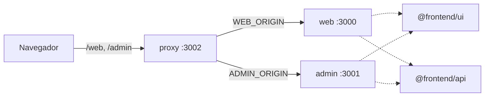

# Media Core

O Media Core é uma plataforma de gerenciamento e administração de conteúdos multimídia, com foco principal no painel administrativo. A intenção funcional é que o **Admin** gerencie conteúdos, usuários, acessos e configurações, enquanto a **Web** ofereça autenticação, navegação e consumo dos conteúdos disponibilizados. A base atual usa TypeScript e Next.js, organizada como monorepo com **pnpm** (gerenciador de pacotes) e **Turborepo** (orquestrador de tarefas). **Decisão oficial:** o Lerna foi descartado e não é utilizado. As aplicações independentes (`web`, `admin` e `proxy`) compartilham bibliotecas internas (`@frontend/ui`, `@frontend/api`) que não são publicadas no npm.

> Esta documentação descreve o que foi **inspecionado nos arquivos** e **executado** durante a sua elaboração. Não é uma promessa de prontidão para produção. Veja [docs/status-and-next-steps.md](docs/status-and-next-steps.md).
>
> **Fora do escopo desta etapa:** Kubernetes. Os manifests em `deploy/kubernetes/` existem, mas a configuração (principalmente o acesso externo) ainda não está finalizada e **não é documentada aqui**.

## Legenda de evidências

| Marca            | Significado                                                                             |
| ---------------- | --------------------------------------------------------------------------------------- |
| **[Arquivo]**    | Confirmado lendo arquivos do repositório.                                               |
| **[Testado]**    | Comando executado com sucesso durante a elaboração desta documentação (28/10/2026).     |
| **[Histórico]**  | Resultado de teste anterior, relatado em `context/project-context.md`; não reexecutado. |
| **[A testar]**   | Comando coerente com os arquivos, mas não executado.                                    |
| **[Intenção]**   | Decisão ou objetivo informado pelo usuário (não necessariamente implementado).          |
| **[Inferência]** | Dedução a partir dos arquivos; o motivo ou o efeito não foi confirmado.                 |
| **[Pendente]**   | Sem validação ou decisão.                                                               |
| **[Relato]**     | Informação fornecida sobre estado ou execução, não revalidada nesta documentação.       |

## Visão geral

| Caminho        | Papel                                                               | Porta | `basePath` |
| -------------- | ------------------------------------------------------------------- | ----- | ---------- |
| `apps/web`     | Aplicação Next.js Web                                               | 3000  | `/web`     |
| `apps/admin`   | Aplicação Next.js Admin                                             | 3001  | `/admin`   |
| `apps/proxy`   | Gateway Next.js: encaminha `/web/*` e `/admin/*` por Route Handlers | 3002  | —          |
| `packages/ui`  | `@frontend/ui`: MUI, tema, componentes e Storybook                   | —     | —          |
| `packages/api` | `@frontend/api`: hoje só `getApiStatus()` de exemplo                | —     | —          |
| `configs/`     | Base de ESLint e TypeScript compartilhada                           | —     | —          |



## Início rápido

Pré-requisitos: Node `26.12.1`, pnpm `12.15.0`, Docker (opcional). Guia completo: [docs/getting-started.md](docs/getting-started.md).

```bash
pnpm install --frozen-lockfile
pnpm dev                       # web :3000, admin :3001, proxy :3002
curl -I http://localhost:3002/web      # via proxy
```

Para build do monorepo com o Quality Gate global, use `pnpm build`; o fluxo e alternativas direcionadas estão em [docs/commands-reference.md](docs/commands-reference.md#scripts-do-monorepo-raiz).

Ou, com contêineres:

```bash
cp .env.example .env
docker compose up -d --build   # proxy publicado em http://localhost:3002
docker compose down
```

## Documentação

| Documento                                                      | Conteúdo                                                                                     |
| -------------------------------------------------------------- | -------------------------------------------------------------------------------------------- |
| [docs/project-goals.md](docs/project-goals.md)                 | Ideia, princípios, por que monorepo, custos e limites                                        |
| [docs/architecture.md](docs/architecture.md)                   | Estrutura, apps, pacotes, dependências, fluxo de requisição                                  |
| [docs/getting-started.md](docs/getting-started.md)             | Pré-requisitos, instalação, primeiro uso                                                     |
| [docs/environment.md](docs/environment.md)                     | Variáveis de ambiente: `.env`, `.env.example`, `apps/proxy/.env.local`, valores por ambiente |
| [docs/local-development.md](docs/local-development.md)         | Executar apps, trabalhar em bibliotecas, validar mudanças                                    |
| [docs/docker.md](docs/docker.md)                               | Dockerfiles, build e execução de cada imagem isoladamente                                    |
| [docs/docker-compose.md](docs/docker-compose.md)               | Ambiente completo, operação por serviço, testes do proxy                                     |
| [docs/vercel.md](docs/vercel.md)                               | Deploy do frontend com Vercel Services, configurações e alternativas arquiteturais             |
| [docs/proxy.md](docs/proxy.md)                                 | Regras do proxy, erros, redirects, rotas de teste                                            |
| [docs/commands-reference.md](docs/commands-reference.md)       | Comandos do monorepo/apps, Storybook, Quality Gate e estado de validação                     |
| [docs/file-map.md](docs/file-map.md)                           | Para que serve cada arquivo de configuração                                                  |
| [docs/decisions.md](docs/decisions.md)                         | Decisões com estado, evidência e motivo                                                      |
| [docs/troubleshooting.md](docs/troubleshooting.md)             | Sintomas, causas e verificações                                                              |
| [docs/status-and-next-steps.md](docs/status-and-next-steps.md) | O que funciona, o que está pendente                                                          |

`context/project-context.md` e `prompts/documentation-agent.md` são insumos usados para produzir esta documentação, não documentação de produto.

## Status resumido

- **[Testado antes da renomeação]** `pnpm install --frozen-lockfile`, `typecheck`, `lint`, `build`, `pnpm dev` (tudo e cada app), imagens Docker, `docker run` isolado e Docker Compose (incluindo parar o `web`, recuperar e timeout 504 do proxy). Os novos nomes de imagem e de projeto Compose ainda não foram testados.
- **Achados registrados** (detalhes e limitações em [docs/status-and-next-steps.md](docs/status-and-next-steps.md#achados-registrados)): o Lerna foi descartado por decisão oficial; `proxy-redirect-test` não exercita a reescrita de `Location` em Docker/Compose; o `.env` da raiz só serve ao Compose; sobras do scaffold em `web`/`admin`; `@frontend/ui` incompleto; existem páginas `proxy-test` além das 4 rotas de teste.
- **Deploy Vercel:** o histórico informado para esta etapa registra os três serviços ativos em Vercel Services; detalhes e limites de validação em [docs/vercel.md](docs/vercel.md). **[Relato]**
- **Quality Gate:** builds invocados pelo Turbo dependem da verificação global de ESLint e Prettier; comandos e limites da integração Vercel pendente em [docs/commands-reference.md](docs/commands-reference.md) e [docs/vercel.md](docs/vercel.md).
- **Storybook:** ambiente de desenvolvimento e documentação dos componentes de `@frontend/ui`; comandos, tema e avisos conhecidos em [docs/local-development.md](docs/local-development.md#storybook-da-biblioteca-ui).
- **Docker:** as imagens executam o `server.js` do standalone; as apps não têm script `start`. Docker continua documentado como forma de execução própria em [docs/docker.md](docs/docker.md), não como único destino de produção.
- **[Pendente]** Deploy do backend; autenticação/autorização (não implementadas); destino das rotas de teste; Kubernetes (etapa posterior).
