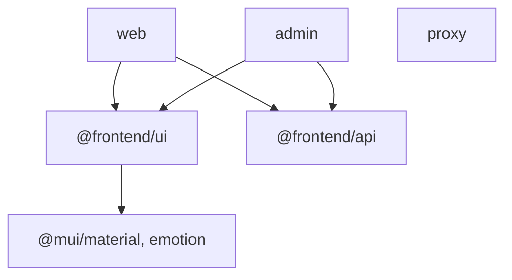

# Arquitetura

Legenda das marcas: [README](../README.md#legenda-de-evidências). Objetivos e motivos: [project-goals.md](project-goals.md).

## Estrutura de diretórios **[Arquivo]**

```text
.
├── apps/
│   ├── web/        # Next.js, porta 3000, basePath /web
│   ├── admin/      # Next.js, porta 3001, basePath /admin
│   └── proxy/      # Next.js, porta 3002, gateway por Route Handlers
├── packages/
│   ├── ui/         # @frontend/ui  (MUI, tema, AppButton)
│   └── api/        # @frontend/api (getApiStatus de exemplo)
├── configs/
│   ├── eslint/     # base.mjs e next.mjs, compartilhados
│   └── typescript/ # base.json, estendido por apps e pacotes
├── deploy/         # manifests Kubernetes (fora do escopo desta documentação)
├── docs/           # esta documentação
├── context/ prompts/   # insumos de documentação
├── compose.yaml    # Docker Compose: web, admin, proxy
├── turbo.json  pnpm-workspace.yaml  package.json  ...
```

O `pnpm-workspace.yaml` declara `apps/*` e `packages/*` como projetos do workspace. Projetos reconhecidos pelo pnpm **[Testado antes da renomeação]** (`pnpm ls -r`): `media-core` (raiz, atualizado em `package.json`), `web`, `admin`, `proxy`, `@frontend/ui`, `@frontend/api`.

## Aplicações

### `apps/web` e `apps/admin`

- Aplicações Next.js 16.4.3 / React 19.3.0 distintas, com App Router (`src/app`). **[Arquivo]**
- `next.config.ts` (quase idêntico nas duas): `basePath` (`/web` ou `/admin`), `cacheComponents: true`, `partialPrefetching: true`, `transpilePackages: ["@frontend/ui", "@frontend/api"]`, `output: "standalone"` e `outputFileTracingRoot` apontando para a raiz do monorepo. **[Arquivo]**
- `layout.tsx` (igual nas duas): fonte Roboto via `next/font/google` (variável CSS `--font-roboto`) e `<ThemeRegistry>` de `@frontend/ui`. **[Arquivo]**
- `web` usa `getApiStatus()` de `@frontend/api` e `AppButton` de `@frontend/ui` na página inicial (`page.tsx`, `ButtonTest.tsx`). `admin` não usa as funções da biblioteca além do `ThemeRegistry`. **[Arquivo]**
- Páginas iniciais ainda são o template do `create-next-app` (logos, links Vercel). **[Arquivo]**
- Rotas e páginas de teste: ver [proxy.md](proxy.md#rotas-de-teste-temporárias). **[Arquivo]**
- `error.tsx` em cada app: tela de erro genérica com botão "Tentar novamente". **[Arquivo]**

### `apps/proxy`

- Aplicação Next.js que serve a própria página em `/` ("Application Gateway") e encaminha `/web` e `/admin` para as outras apps. **[Arquivo]**
- Encaminhamento por **Route Handlers** (`src/app/web/[[...path]]/route.ts`, `src/app/admin/[[...path]]/route.ts`) que chamam `forwardRequest()` em `src/lib/forward-request.ts`. Detalhes em [proxy.md](proxy.md). **[Arquivo]**
- `next.config.ts` tem `output: "standalone"` e `outputFileTracingRoot`; **não** tem `basePath`, `transpilePackages` nem rewrites ativos (um bloco de rewrites antigos está só comentado, como referência). **[Arquivo]**
- Não depende de `@frontend/ui` nem de `@frontend/api`. **[Arquivo]**
- `proxy.example.ts` é um exemplo **comentado** de bloqueio de rotas; não é carregado (o arquivo precisaria se chamar `proxy.ts`). **[Arquivo]**

## Pacotes compartilhados

| Pacote          | Export público **[Arquivo]** | Conteúdo                                                                                                                                                                                                                                                    |
| --------------- | ---------------------------- | ----------------------------------------------------------------------------------------------------------------------------------------------------------------------------------------------------------------------------------------------------------- |
| `@frontend/ui`  | `AppButton`, `ThemeRegistry` | `ThemeRegistry` (`"use client"`: `AppRouterCacheProvider` + `ThemeProvider` + `CssBaseline`), `theme` (usa `palette`, `typography` e `tokens.spacing`/`tokens.radius`), `tokens` (exportado), `AppButton` (`<button>` simples, com o tipo `AppButtonProps`) |
| `@frontend/api` | `getApiStatus`               | Função de exemplo que retorna `"API package connected"`                                                                                                                                                                                                     |

Como são consumidos:

- Nas apps, a dependência é `"@frontend/ui": "workspace:*"` (idem `api`) em `package.json`: o pnpm cria um link simbólico para a pasta do pacote. **[Arquivo]**
- Os pacotes **não têm etapa de build**: `package.json` aponta `types` e `exports` para arquivos de `src` (TypeScript puro). **[Arquivo]**
- Por isso as apps listam `transpilePackages`: o Next.js compila o TypeScript dos pacotes junto com a app. **[Inferência]** sobre o motivo (o efeito de `transpilePackages` é padrão do Next.js; a motivação do projeto não foi confirmada).
- `exports` define estes formatos de import, todos **[Testado]** (TypeScript, `next build` e dev): `@frontend/ui` (componentes, tipos, `ThemeRegistry`, `tokens`), `@frontend/ui/theme` (`ThemeRegistry`, `tokens`), `@frontend/ui/theme/<arquivo>` (ex.: `@frontend/ui/theme/tokens`, `@frontend/ui/theme/theme`; só arquivos `.ts`) e `@frontend/ui/<Componente>` (ex.: `@frontend/ui/AppButton`, resolvido para `src/components/<Componente>/index.tsx`). `@frontend/ui/src/...` não resolve. Os alvos de `exports` precisam ter extensão/arquivo explícito: sem isso o bundler resolve, mas o TypeScript não (`TS2307`). **[Arquivo]**
- Exemplo real: `import { AppButton } from "@frontend/ui";` em `apps/web/src/app/ButtonTest.tsx`. **[Arquivo]**
- Os scripts dos pacotes são apenas `lint` e `typecheck`; não há `dev` nem `build` neles. **[Arquivo]**

## Dependências entre projetos



- `proxy` não importa código de `web`/`admin`; fala com elas por HTTP, usando `WEB_ORIGIN` e `ADMIN_ORIGIN`. **[Arquivo]**
- Em `turbo.json`, `build`, `lint` e `typecheck` têm `dependsOn: ["^..."]`, ou seja, uma tarefa de uma app roda antes as tarefas das suas dependências de workspace. **[Arquivo]** Efeito observado: `turbo run lint --filter=admin` executou 3 tarefas (admin, `@frontend/api`, `@frontend/ui`). **[Testado]**

## Fluxo de uma requisição pelo proxy

```mermaid
sequenceDiagram
  participant N as Navegador
  participant P as proxy (:3002)
  participant W as web (:3000)
  N->>P: GET /web/proxy-test
  Note over P: route.ts de /web/[[...path]] → forwardRequest(request, "web")
  P->>W: GET WEB_ORIGIN/web/proxy-test (sem host, sem hop-by-hop, redirect manual, timeout 10 s)
  W-->>P: resposta (status, headers, corpo)
  P-->>N: mesma resposta (Location interno reescrito; 5xx em navegação HTML vira página amigável)
```

1. O navegador acessa o proxy (`/web/...` ou `/admin/...`). **[Arquivo]**
2. O proxy mantém o **caminho completo** (`/web/...`) ao chamar o destino; por isso o `basePath` de cada app é o mesmo prefixo do proxy. **[Arquivo]** **[Testado]**
3. A resposta volta ao navegador com ajustes descritos em [proxy.md](proxy.md).
4. Qualquer outro caminho (`/foo`) não é encaminhado: responde 404 do próprio proxy. **[Testado]**

## Deploy na Vercel

O frontend é implantado como três Vercel Services no mesmo projeto: o rewrite público encaminha todas as requisições ao Proxy, que chama Web e Admin por bindings. Configuração, instalação, builds, settings informados no Dashboard e a alternativa de projetos separados estão em [vercel.md](vercel.md).

## Papel de cada configuração do Next.js

| Configuração                            | Onde                    | O que faz / observado                                                                                                                                                                             |
| --------------------------------------- | ----------------------- | ------------------------------------------------------------------------------------------------------------------------------------------------------------------------------------------------- |
| `basePath`                              | web, admin              | Todas as rotas e assets da app vivem sob `/web` ou `/admin` (ex.: `/web/next.svg`; `http://localhost:3000/` dá 404 **[Testado]**). Permite ao proxy usar o mesmo prefixo sem reescrever caminhos. |
| Portas                                  | `package.json` das apps | `next dev -p <porta>`: 3000, 3001, 3002 (as apps não têm script `start`). Em contêiner, o `server.js` do standalone usa `PORT` (definido no `ENV` da imagem). **[Arquivo]**                       |
| `transpilePackages`                     | web, admin              | Lista `@frontend/ui` e `@frontend/api` (código TypeScript sem build). **[Arquivo]**                                                                                                               |
| `output: "standalone"`                  | web, admin, proxy       | Gera `.next/standalone` com `server.js` e só as dependências rastreadas; é o que as imagens Docker copiam. **[Arquivo]**                                                                          |
| `outputFileTracingRoot`                 | web, admin, proxy       | `path.resolve(process.cwd(), "../..")`: assume execução a partir de `apps/<app>` e inclui na trilha arquivos da raiz do monorepo. O comentário em `web` diz isso. **[Arquivo]**                   |
| `cacheComponents`, `partialPrefetching` | web, admin              | Ativados nas duas; o log do `next dev` mostra "Cache Components enabled" e "Partial Prefetching enabled". Motivação não confirmada. **[Arquivo]** **[Testado]**                                   |

## Segurança e autenticação

Não há autenticação nem autorização implementadas **[Arquivo]**. Os comentários em `forward-request.ts` e em `proxy.example.ts` afirmam que o encaminhamento não substitui autenticação/autorização nos serviços responsáveis pelos dados.

## Observações sobre a base atual **[Arquivo] / [Testado]**

- `apps/web` e `apps/admin` ainda contêm `pnpm-lock.yaml` próprios (vindos do scaffold), mas não têm `pnpm-workspace.yaml`; a configuração está consolidada no workspace raiz `frontend/`. **[Arquivo]** Ver [vercel.md](vercel.md).
- `apps/web/README.md` e `apps/admin/README.md` são o texto padrão do `create-next-app`. `AGENTS.md` nas duas apps é gerado pelo Next.js e orienta a consultar `node_modules/next/dist/docs/`.
